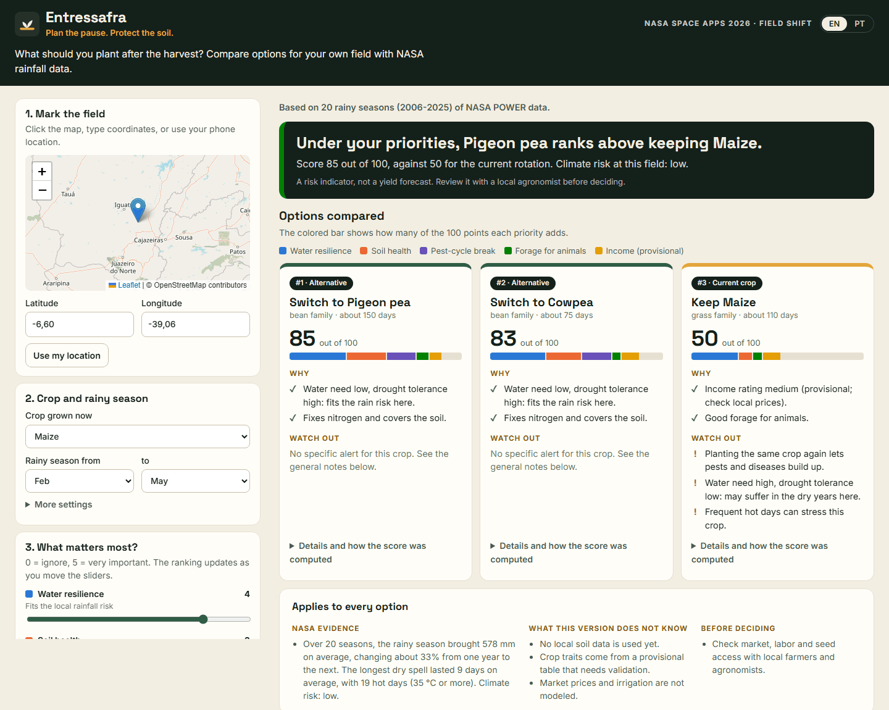
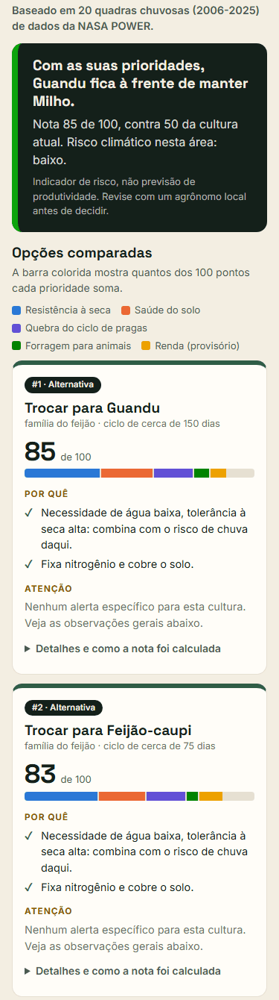

# Entressafra

**Plan the pause. Protect the soil.**

Entressafra (Portuguese for the interval between one harvest and the next planting) is a decision-support web tool that helps farmers compare crop-rotation strategies using NASA Earth observation data. It was built for the **NASA Space Apps Challenge 2026, challenge "Field Shift"**, which asks teams to help farms adapt using NASA data. Our answer focuses on one decision that farmers in the Brazilian semi-arid make every year: what to plant after the harvest, when the rain is short and unpredictable.

- **Live demo:** https://teogenes18.github.io/entressafra/
- **Demo slides:** **[add the public link here]**

| Desktop: controls stay on the left, results update on the right | Phone (Portuguese) |
|---|---|
|  |  |

## Try it in 60 seconds

1. Open the live demo and press **"Compare rotation strategies"**. The map starts at Cedro, Ceará, in the Brazilian semi-arid, and the tool fetches 20 rainy seasons of NASA POWER data for that point.
2. Read the one-line verdict, then the climate panel: in the same field, the wettest season had **about 3 times** the rain of the driest.
3. Move the **"What matters most?"** sliders. The ranking updates instantly, and each card shows exactly how many points each priority added.
4. Click anywhere else on the map and press **Compare** again: the tool fetches NASA POWER data for the new point.
5. Switch **EN / PT** at the top: the tool speaks Portuguese for the farmers it was built for.

## The problem

In the semi-arid Northeast of Brazil, the rain that matters falls in a short season, and it changes a lot from year to year. NASA POWER data for Cedro, Ceará (1996-2025, `PRECTOTCORR`):

- February to May brings **67%** of the yearly rain on average.
- The February-May season had **795 mm in 2009** and **382 mm in 2012** (yearly totals: 1,145 mm and 487 mm).

These numbers are checked by an automated test against the saved NASA response (`tests/power.test.js`). With that much variation, choosing what to plant after the harvest is a bet. Entressafra turns 20 to 30 years of NASA data for the farmer's own point into a clear, explained comparison.

## What it does

1. The user marks a field on a map (or uses the phone location).
2. The user chooses the current crop, the rainy season (it can cross the new year, e.g. November to March) and what matters most: water resilience, soil health, pest-cycle break, forage, income.
3. The tool pulls daily rainfall and maximum temperature from **NASA POWER**, turns them into simple climate indicators and a climate risk indicator, and finds the **entressafra window** (the months too dry to farm without irrigation).
4. It compares **three rotation strategies**: the current rotation plus the two best alternatives. Each one shows **why it was suggested, the NASA evidence, possible benefits, information gaps, and risks to review locally**, plus a table with every number behind its score.

The tool is a **risk indicator, not a yield forecast**. It supports the farmer's judgment and does not replace local experience.

## How it works

```
NASA POWER daily data ──► climate indicators ──────► transparent weighted score ──► ranked strategies
(rainfall, max temp)      season rain, variation,     farmer priorities are          with reasons, evidence,
                          dry spells, hot days,       the weights                    gaps and risks
                          entressafra window
```

Formulas and thresholds: [docs/methodology.md](docs/methodology.md). Data details: [docs/data-sources.md](docs/data-sources.md).

## NASA data used

The code uses **one** NASA data source:

| Dataset | Variables | Use | Links |
|---|---|---|---|
| **NASA POWER** (Prediction Of Worldwide Energy Resources), Daily API, point query, Agroclimatology (AG) community | `PRECTOTCORR` (precipitation corrected, mm/day) and `T2M_MAX` (maximum air temperature at 2 m, °C) | Season rainfall, year-to-year variation, dry spells, hot days, monthly rainfall, entressafra window | [Project](https://power.larc.nasa.gov/) · [Daily API docs](https://power.larc.nasa.gov/docs/services/api/temporal/daily/) |

The tool works for **any point on Earth**: when the user presses "Compare", it queries the NASA POWER API live for that point (no API key needed). One NASA POWER response, for Cedro, Ceará (1996-2025), is also saved unchanged in [data/nasa-power-cedro-1996-2025.json](data/nasa-power-cedro-1996-2025.json). It is used only as a fallback near Cedro, if the API does not answer. The page always says which source it used. Details: [docs/data-sources.md](docs/data-sources.md).

No other NASA dataset is used in this version (SMAP, GPM, MODIS and Landsat are listed under "Next steps" only).

### Other external resources

| Resource | Use | License / terms |
|---|---|---|
| [OpenStreetMap](https://www.openstreetmap.org/copyright) tiles | Base map | © OpenStreetMap contributors, ODbL |
| [Leaflet](https://leafletjs.com/) 1.9.4, loaded from [unpkg](https://unpkg.com/) | Interactive map | BSD-2-Clause |
| [Google Fonts](https://fonts.google.com/): Inter and Space Grotesk | Typography | SIL Open Font License |
| Crop traits table in [data/crops.json](data/crops.json), written for this project | Crop scoring | Provisional values; must be validated against sources such as [Embrapa](https://www.embrapa.br/) |

## Code map

The app is plain HTML, CSS and JavaScript modules: no framework, no build step. Each file has one job:

| File | Job |
|---|---|
| [index.html](index.html) | Page structure. Texts come from `js/i18n.js`. |
| [js/app.js](js/app.js) | Entry point: reads the form, loads data, runs the analysis, handles the map and language. |
| [js/power.js](js/power.js) | NASA POWER client: builds the request, parses it, timeout, saved-data fallback. |
| [js/indicators.js](js/indicators.js) | Pure functions: season indicators, monthly rain, entressafra window, climate risk. |
| [js/scoring.js](js/scoring.js) | Pure functions: part-scores, weighted score with its breakdown, strategy explanations. |
| [js/render.js](js/render.js) | Draws the results on the page. No calculations. |
| [js/charts.js](js/charts.js) | Small SVG charts, no chart library. |
| [js/i18n.js](js/i18n.js) | Every text in English and Portuguese. |
| [data/crops.json](data/crops.json) | Provisional crop traits (must be validated). |
| [tests/](tests/) | Unit tests (Node's built-in test runner). |

Calculation never touches the page, and the page never calculates. That is why the indicators and the scores can be tested without a browser.

## Run it locally

You need [Node.js](https://nodejs.org) 20 or newer. No install step.

```bash
npm start      # serves the app at http://localhost:8000
npm test       # runs the unit tests
```

If port 8000 is busy, choose another one: `PORT=8080 npm start` (macOS/Linux) or `$env:PORT=8080; npm start` (Windows PowerShell).

Any static server also works, for example `python -m http.server 8000`. On Windows, use `python` or `py` instead of `python3`, because `python3` opens the Microsoft Store shortcut.

## Limits (please read)

- The score is a **risk indicator**, not a prediction of yield or profit.
- The results **need local validation**: every suggestion must be reviewed by farmers and agronomists who know the field before anyone acts on it.
- `data/crops.json` is a **provisional table** of crop traits. Every row must be checked against sources such as Embrapa and edited by an agronomist.
- No local soil data, market prices, irrigation, labor or seed access are modeled in this version.
- The climate thresholds are provisional (see the methodology).
- NASA POWER data is gridded (about 0.5°) and describes an area, not one field.

## Next steps

- Add NASA soil-moisture, rainfall and vegetation datasets (for example SMAP, GPM IMERG, MODIS/Landsat NDVI) and local soil data.
- Validate the crop table and the thresholds with farmers and agronomists.
- Pilot in Ceará with local partners.

## Use of AI

**[Team: check every line of this section, complete the bracketed parts and delete this note before submitting.]**

We used **Claude** (Anthropic), through the Claude Code coding assistant, during development.

- **What the AI did:** it wrote most of the JavaScript, CSS and HTML, the unit tests and the documentation in this repository, following the team's instructions. It also checked the rainfall figures in this README against the NASA POWER data, and found that some numbers in an earlier draft of our slides did not match the data.
- **What the team did:** [describe it honestly, for example: chose the challenge and the problem, defined the idea and the features, chose the crops and the region, tested the app, reviewed the code and the texts, made the slides].
- **Crop table:** [say who drafted the values in data/crops.json, a person or the AI. In both cases they are provisional and not validated yet].
- **What the AI did not do:** it did not create data. Every climate number comes from NASA POWER, either live from the API or from the saved API response in `data/`.

## Team

Team Big Three, IFCE Campus Cedro, Ceará, Brazil.

- **[TEOGENES ANTONIO CORDEIRO BISNETO]**:
- **[CAIQUE DE SOUZA OLIVEIRA]**: 
- **[JOSE CARLOS PINHEIRO RAMALHO]**: 

## License

Code: MIT. See [LICENSE](LICENSE). NASA POWER data is provided by NASA's Langley Research Center; map data © OpenStreetMap contributors.
